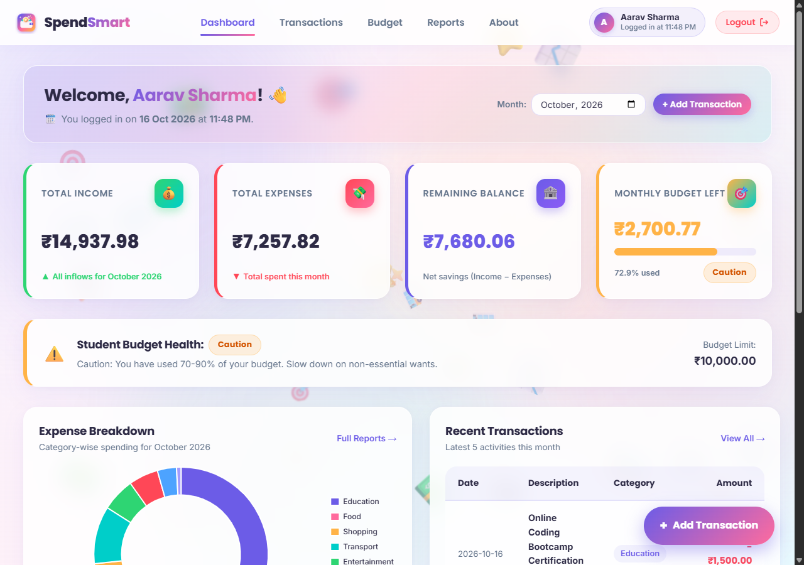
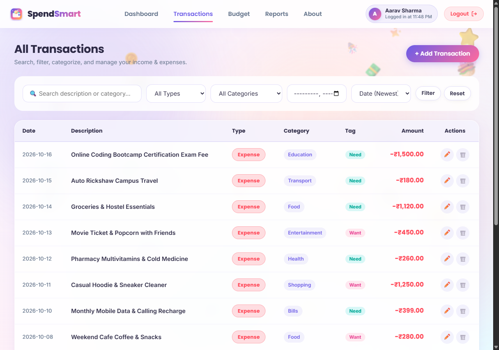
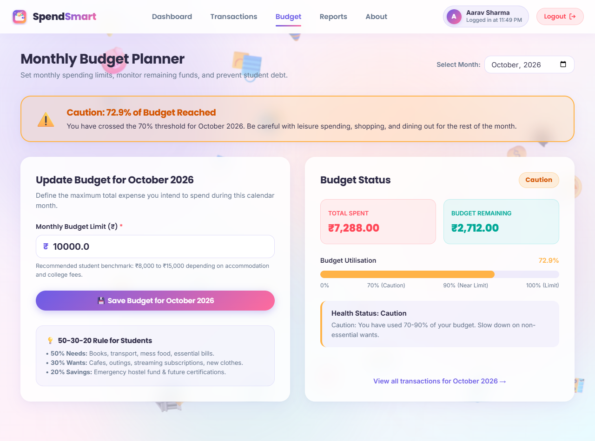
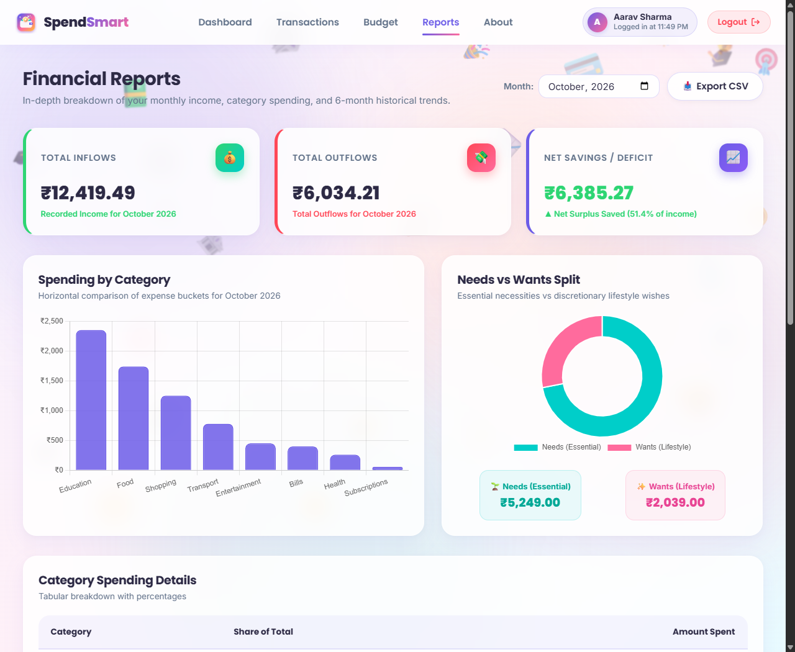
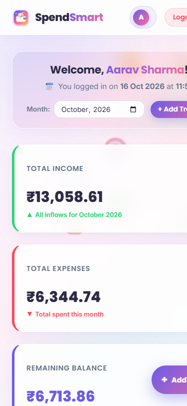

<div align="center">

  

  # SpendSmart — Personal Expense Tracker

  **Spend smart. Save smarter.**

  [](https://www.python.org/)
  [](https://flask.palletsprojects.com/)
  [](https://www.sqlite.org/)
  [](https://vercel.com/)
  [](LICENSE)

  <br>

  ### 🌐 Live Demo: **[https://<your-vercel-url>](https://<your-vercel-url>)**
  *(Replace `<your-vercel-url>` with your deployed Vercel domain)*

</div>

---

## 📖 Overview

**SpendSmart** is a colorful, modern, and accessible personal expense tracker application tailored for students, scholars, and early-career professionals. Built with **Python, Flask, SQLite, and vanilla HTML5/CSS3/JavaScript**, it empowers users to record daily expenditures, categorize spending into **Needs vs Wants**, track monthly limits with real-time budget health indicators, and analyze cash-flow trends without requiring external database servers or subscription fees.

---

## 📸 Screenshots Showcase

<div align="center">

### 1. Centered Login Screen with Live Clock & Floating Animated Icons


<br><br>

### 2. Financial Dashboard with Health Indicator, Summary Cards & Charts


<br><br>

### 3. Transactions Ledger with Search, Filters & Need/Want Tags


<br><br>

### 4. Monthly Budget Planner with Threshold Warning Alerts


<br><br>

### 5. Detailed Financial Reports & 6-Month Comparison Trends


<br><br>

### 6. Fully Responsive Mobile Experience


</div>

---

## ✨ Features

- **Passwordless 3-Field Sign In:** Clean login interface requiring only **Full Name**, **Email ID**, and a **10-digit Indian Mobile Number** (optional `+91` prefix).
- **Live Clock Badge:** Live-updating Indian Standard Time (IST) clock ticking every second on the login card.
- **Dynamic Background Animation (`static/js/background.js`):** 25+ floating finance icons (`💰 🪙 💵 💳 🏦 🛍️ 🍔 🚌 🎓 📈 🎯 🐷 ⭐ ✨ 🎉`) drifting with gentle wobbles, periodic popping confetti bursts, and interactive mouse/touch triggers.
- **Student Budget Health Indicator:** 4-tier Python calculation rules:
  - 🟢 **On Track:** `<70%` budget used
  - 🟡 **Caution:** `70% – 90%` budget used
  - 🟠 **Near Limit:** `>90% – 100%` budget used
  - 🔴 **Over Budget:** `>100%` budget used (critical warning alert)
- **Needs vs Wants Tagging:** Classify expenses into essential living necessities vs discretionary wishes, visualized through Chart.js split charts.
- **Instant Demo Data Loader:** Pre-populates ₹15,000 allowance income, 12 categorized student expenses, and a ₹10,000 budget with a single click.
- **Full Transaction Management:** Add, edit, search, filter by type/category/month, sort by date/amount, and delete with an accessible confirmation dialog.
- **Visual Analytics:** Chart.js doughnut breakdowns, category bar charts, and 6-month historical cash-flow trends.
- **CSV Data Export:** 1-click download of spreadsheet-safe statement files with spreadsheet formula injection defense.
- **Indian Rupee Formatting:** Strict adherence to Indian numbering formatting (`₹15,000.00`, `₹1,25,000.50`).

---

## 🛠️ Tech Stack

| Component | Technology | Description |
| :--- | :--- | :--- |
| **Backend** | Python 3.10+ / Flask 3.x | Lightweight WSGI web framework, session management, validation |
| **Database** | SQLite 3 (Built-in) | Serverless relational database with parameterized queries (No ORM) |
| **Frontend** | HTML5 & Vanilla CSS3 | Custom design system, CSS variables, glassmorphism, responsive flexbox/grid |
| **Interactivity** | Vanilla JavaScript (ES6+) | Live clock, floating/popping particle animation, modal dialogs, count-up numbers |
| **Charts** | Chart.js 4.4 (CDN) | Interactive doughnut, bar, and comparative cash flow charts |
| **Typography** | Google Fonts | **Poppins** for headings and branding; **Inter** for clean body text |
| **Deployment** | Vercel Serverless | Python WSGI entrypoint (`api/index.py`) with automatic `/tmp` SQLite handling |
| **Testing** | Pytest 9.x | 26 automated unit and integration tests (100% pass rate) |

---

## 📁 Project Structure

```
SpendSmart/
├── api/
│   └── index.py            # Vercel serverless function entry point
├── app.py                  # Flask routes, sessions, auth guards, error handlers
├── database.py             # SQLite connection, queries, validations, budget rules
├── vercel.json             # Vercel deployment routing & bundle configuration
├── .vercelignore           # Excludes tests, databases, and local artifacts
├── requirements.txt        # Production dependencies (Flask)
├── requirements-dev.txt    # Development & test dependencies (pytest)
├── .python-version         # Python runtime version for Vercel (3.12)
├── .env.example            # Environment variables template
├── .gitignore              # Git ignore rules for virtualenvs, caches, .db files
├── LICENSE                 # MIT License (Copyright © 2026 Om Jawale)
├── README.md               # Documentation and showcase
├── screenshots/            # Application capture images
│   ├── login_page.png
│   ├── dashboard.png
│   ├── transactions.png
│   ├── budget.png
│   ├── reports.png
│   └── mobile_view.png
├── tests/
│   └── test_app.py         # 26 automated pytest tests
├── templates/
│   ├── base.html           # Sticky glass navbar, user chip, toasts, background canvas
│   ├── login.html          # Centered card, 160px floating logo, live clock badge
│   ├── dashboard.html      # Welcome banner, 4 summary cards, doughnut chart, FAB
│   ├── transactions.html   # Search, filters, sort, ledger table, delete modal
│   ├── transaction_form.html # Add/edit form, dynamic categories, Needs vs Wants
│   ├── budget.html         # Monthly limit form, threshold alerts, 50-30-20 tips
│   ├── reports.html        # Category bar chart, Needs/Wants chart, 6-month trends, CSV
│   ├── about.html          # Architecture overview, certification note, cloud note
│   ├── 404.html            # Custom 404 error page
│   └── 500.html            # Custom 500 error page
└── static/
    ├── css/
    │   └── style.css       # Custom fintech theme, animations, responsive breakpoints
    ├── js/
    │   ├── app.js          # Live clock, validation, metric count-up, modals
    │   └── background.js   # Floating finance icons, drifting blobs, particle pop bursts
    └── images/
        ├── spendsmart-logo.svg # Original SVG logo emblem (wallet, coin, growth arrow)
        └── favicon.svg     # Matching browser tab favicon
```

---

## 💻 Running Locally

### 1. Clone the Repository
```bash
git clone https://github.com/JawaleOm/SpendSmart.git
cd SpendSmart
```

### 2. Create and Activate a Virtual Environment
```bash
# Windows PowerShell
python -m venv .venv
.\.venv\Scripts\Activate.ps1

# macOS / Linux
python3 -m venv .venv
source .venv/bin/activate
```

### 3. Install Dependencies
```bash
pip install -r requirements.txt
pip install -r requirements-dev.txt
```

### 4. Run Pytest Tests
```bash
pytest tests/
```
*(All 26 tests will pass in ~1.8s)*

### 5. Launch the Application
```bash
python app.py
```
Open your browser and navigate to: **[http://127.0.0.1:5000](http://127.0.0.1:5000)**

---

## ☁️ Deploying to Vercel

SpendSmart is pre-configured for seamless 1-click deployment to **Vercel**:

### Step-by-Step Instructions:
1. Log in to your [Vercel Dashboard](https://vercel.com/) with GitHub.
2. Click **Add New...** &rarr; **Project**.
3. Import the **`JawaleOm/SpendSmart`** repository.
4. Set **Framework Preset** to **Other** (leave Root Directory as `./`).
5. In **Environment Variables**, add:
   - `SECRET_KEY`: Generate a secure 32-byte secret (e.g. run `python -c "import secrets; print(secrets.token_hex(32))"`).
6. Click **Deploy**.

> [!NOTE]
> **Cloud Storage Note:**  
> On Vercel's free serverless tier, SQLite stores data in the ephemeral `/tmp/spendsmart.db` container filesystem, which may reset when serverless instances spin down. For permanent multi-user persistence in production, connect a hosted PostgreSQL database (such as Neon, Supabase, or Vercel Postgres) using the `DATABASE_URL` environment variable.

---

## 👨‍💻 Author

**Om Jawale**  
GitHub: [@JawaleOm](https://github.com/JawaleOm)  
Profile: [https://github.com/JawaleOm](https://github.com/JawaleOm)

---

## 📄 License

This project is licensed under the **MIT License** &mdash; see the [LICENSE](LICENSE) file for details.
